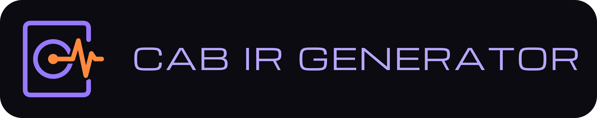
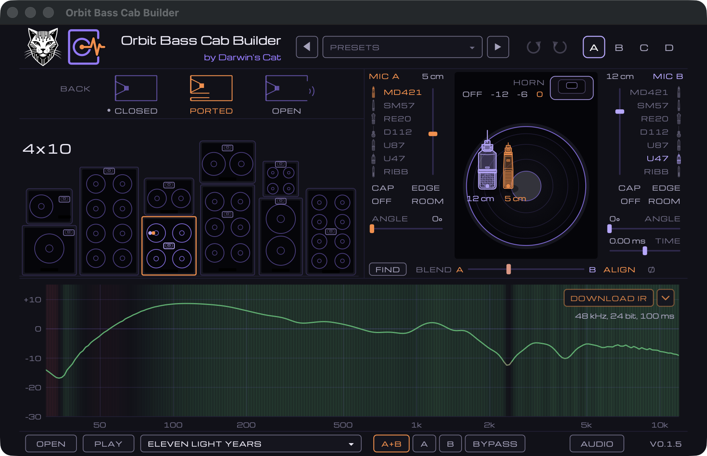
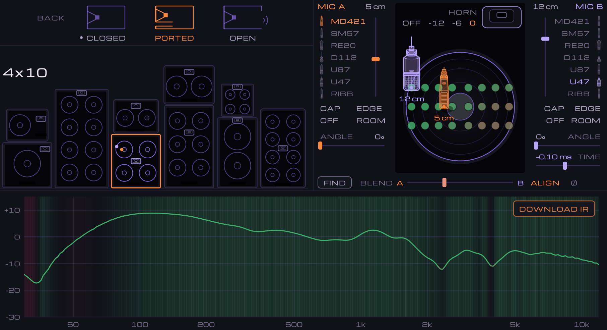

<!-- SPDX-License-Identifier: AGPL-3.0-or-later -->

<p align="center"></p>

# Orbit Bass Cab Builder and Orbit Guitar Cab Builder

Bass cabinet impulse responses, synthesized: a box of each size, its back closed, ported or open, a
horn switched in and out, and up to two mics placed on the speaker — kind, spot, distance, angle and
blend — rendered to a 48 kHz IR while you move them, with the response and where two mics comb drawn
as you go. **Orbit Guitar Cab Builder** is the same on a guitar's cabinets: seven boxes, six speakers and six mics
of its own, and a room round the box: a booth, a studio or a live room.

<p align="center"></p>

One code base for four homes:

- the cabinet panel and its miniature inside Darwin's Cat's bass amps (OrbitBass, RedGrooveBass);
- a standalone app for Windows, macOS and Linux, with a sample player to audition by ear, history,
  undo/redo and A/B/C/D;
- plugins, VST3, AU and CLAP: the same window in a host, the track played through the cabinet;
- a live web page.

## Download

The app is on this repository's [Releases](../../releases) page:

- **macOS** — a `.dmg`, one app for Apple silicon and Intel, signed and notarized; macOS 11 or later.
- **Windows** — a `.zip` with the `.exe`, x64 and arm64.
- **Linux** — a `.tar.gz` with the binary, x86_64 and arm64.

## What it does

**The boxes.** Ten sizes, drawn to scale and stacked as a backline stands them: 1x15, 1x12, 8x10,
4x10, 2x10, 6x10, 2x12, 2x15, 4x6 and 8x8. Over them the box's **back**, closed, ported or open, each
drawn cut through from the side; the box's own is marked with a dot, and a back you turn stays turned
from box to box. A box with a horn has its attenuator: **OFF, −12, −6, 0**.

**The mics.** Up to two, A and B, each one of MD421, SM57, RE20, D112, U87, U47 and a ribbon. Take a
mic on the speaker by any part of it and drag it — or put it at a spot with one click: **CAP**, **EDGE**,
**OFF** (half way out, turned 35° to the cap), **ROOM**. Each has its distance, 1 to 30 cm, and its
angle, up to 60°. Click the lit mic's name to turn that mic off; its column goes dark, and a click in it
brings it back.

**Two mics together.** **BLEND** mixes B into A, **ALIGN** puts the two on one clock, **Ø** turns B over,
and **TIME** moves B against A by up to a millisecond either way. A double click sends TIME back to
nought and BLEND back to the middle.

**FIND.** With two mics it moves B to where the two comb least with each other; with one, it moves that
mic, about where it stands, to where its response has no pit. Every place it tries is drawn on the
speaker as it goes, green to red.

<p align="center"></p>

**The response.** 30 Hz to 12 kHz under it all, following your hand: green where it is fine, red where
it falls into a pit or the two mics cancel. With two mics, a band under it shows where they meet in
phase and where they cancel; the response before your last change stays as a faint grey line.

**DOWNLOAD IR** saves the cabinet that plays as a 24-bit mono WAV at 48 kHz.

**Presets.** 160 of them in eight styles — Funk, Jazz, Metal, Modern, Motown, Punk, Reggae and Rock;
the arrows beside the menu (and the arrow keys) step through them.

**Listening.** A few bass riffs come with the app, or drop a sample of your own on the window — or pick
**INPUT** and play your instrument live through the cabinet from an audio interface, silent until PLAY. **Space**
plays and stops. **HEAR** chooses what you listen through: **A+B**, **A** or **B** alone as it stands in
the pair, or **BYPASS**, the sample with no cabinet at all — for listening only, nothing of the preset
changes. **AUDIO** picks the output device.

**History.** Undo and redo, and four registers, **A B C D**, to keep four cabinets side by side and
compare them; right-click a register to copy the one playing into it.

## Building

CMake 3.22 or later and a C++20 compiler; Ninja is the generator the CI uses.

```sh
cmake -B build -G Ninja -DCMAKE_BUILD_TYPE=Release
cmake --build build
```

JUCE, `felitronics-core`, `felitronics-appkit` and `felitronics-toml` are fetched at the tags
`CMakeLists.txt` pins. A checkout of one beside this repository (`../felitronics-core` and so on) is
used instead when it is there; `-DCABIR_CORE_DIR=` (empty) and the like fetch the pinned tag anyway.

On Linux the app needs, as on Debian or Ubuntu:

```sh
sudo apt-get install ninja-build libasound2-dev libfreetype-dev libfontconfig1-dev \
  libx11-dev libxcomposite-dev libxcursor-dev libxext-dev libxinerama-dev libxrandr-dev \
  libxrender-dev libglu1-mesa-dev mesa-common-dev
```

Options: `CABIR_APP` (the apps), `CABIR_GUITAR_APP` (the guitar's too), `CABIR_PLUGINS`, `CABIR_TOOLS` (the tools below), `CABIR_TESTS`, `CABIR_WEB` (the
page's module, and `irdump`, its check against the native build).

- **The page's module** — `tools/wasm/build.sh`, with Emscripten on the path (or in `~/emsdk`).
- **The IR packs** a page offers — `tools/cabpack.sh`: every preset and the typical cabinets
  (`data/typical.toml`), at 44.1, 48 and 96 kHz.

## Layout

- `src/synth/` — the synthesis, JUCE-free: a cabinet table in, an IR out; the response and its pits,
  and FIND's two searches.
- `src/panel/` — the panel, JUCE-free (`Panel.h`, drawn through `ui/Ui.h`), and `CabPicker.h`, its
  JUCE host; colours and type come from the host.
- `src/web/` — the page's module (WebAssembly): the synthesis and the same panel, drawn on a canvas.
- `app/` — the standalone apps and the plugins.
- `data/` — `cabinets.txt`, the cabinets, mics and positions the synthesis reads; the factory presets;
  the typical cabinets; the riffs.
- `tools/` — `cabgen` renders a table to files, `irlook` reads an IR's response back, `presetcheck`
  and `respread` judge and spread the presets' mic pairs, `cabpack` makes the IR packs.
- `assets/logo/` — the mark, the app's icon drawn from it (`icon.png`, 1024 px), and the lockup with the name.

## Licence

AGPL-3.0-or-later — see [LICENSE](LICENSE). Contributions: see [CONTRIBUTING.md](CONTRIBUTING.md).
