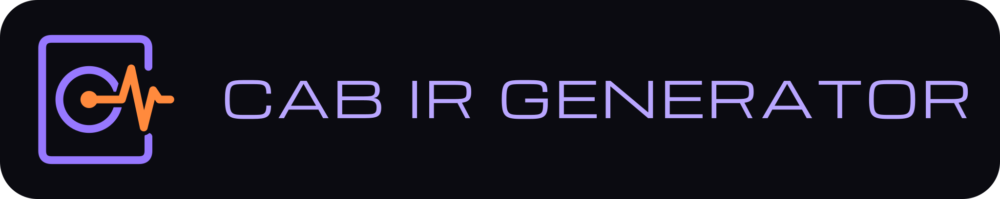
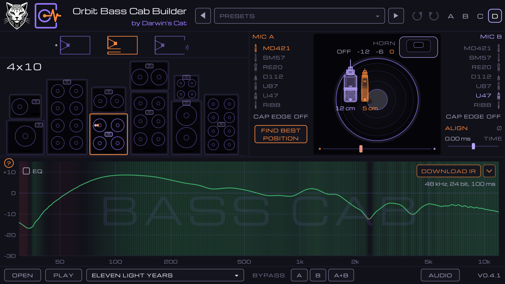
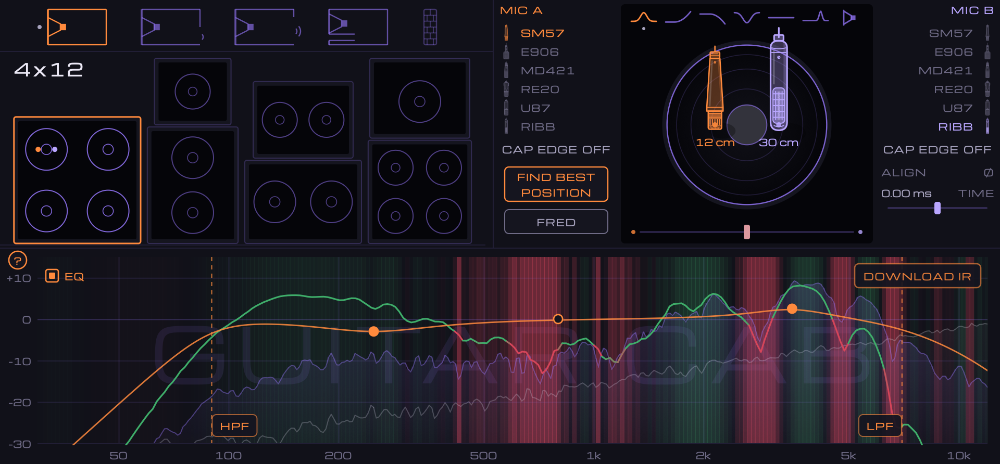

<!-- SPDX-License-Identifier: AGPL-3.0-or-later -->

<p align="center"></p>

# Orbit Bass Cab Builder and Orbit Guitar Cab Builder

IR modellers of bass cabinets and guitar cabinets: they synthesize a cabinet from a physical model and save its
impulse response (IR). Free and open source.

Modelling a cabinet, we take into account:

- **the speakers**
  - every speaker in the box, each heard at the mic from where it stands;
  - its own resonance, and what the box does to it;
  - how a cone moves at every frequency, the way a real one does;
  - the depth of the cone;
  - the voice coil, which takes off the top;
  - the paper cone, on the guitar's;
  - no two speakers quite alike;
- **the box**
  - its back: closed, ported, open or half open;
  - the port, heard apart from the cone;
  - the sound from the back of the cones, coming round the box;
  - the air inside it;
  - the echo inside a closed box;
  - the resonances of its panels;
  - the edges of the baffle;
  - the horn and its crossover, on the bass boxes that have one;
- **around it**
  - the floor under the box;
  - a wall behind it, on the guitar's;
- **the mic**
  - its capsule;
  - its pattern;
  - the proximity effect;
  - where it stands on the cone;
  - how far from it;
  - at what angle;
  - with two mics, how they meet in phase or cancel.

Capturing a real cabinet takes a special room, good mics, a lot of time and experience, and a little luck. Here you
can model all of it right at home, without expensive (and loud 🙉) equipment, see the main mistakes at a glance, and
get an IR ready to use at once.

**Try them in your browser.** Both builders run right on their pages, the same panel with DOWNLOAD IR, nothing to
install: [Orbit Bass Cab Builder](https://darwinscat.com/felitronics/orbit-bass-cab-builder) and
[Orbit Guitar Cab Builder](https://darwinscat.com/felitronics/orbit-guitar-cab-builder). Their presets as ready-made
IR packs, by style and by cabinet size, free under CC BY 4.0: [bass cab IRs](https://darwinscat.com/felitronics/ir/bass-cab-free-irs)
and [guitar cab IRs](https://darwinscat.com/felitronics/ir/guitar-cab-free-irs).

<p align="center"></p>

<p align="center"></p>

Our amps play cabinets made in these builders: [Felitronics Amps](https://github.com/darwinscat/orbit-amp).

## Download

Both builders are on this repository's [Releases](../../releases) page, a download for each, with its app and its
plugins:

- **macOS** — a `.pkg`: the app, VST3, AU and CLAP, for Apple silicon and Intel, signed and notarized; macOS 11 or later.
- **Windows** — an installer `.exe`: the app, VST3 and CLAP, x64 and arm64.
- **Linux** — a `.tar.gz`: the app, VST3 and CLAP, x86_64 and arm64, with how to install them.

The same files are on the builders' pages, with what changed in each version:
[bass](https://darwinscat.com/felitronics/orbit-bass-cab-builder#download) and
[guitar](https://darwinscat.com/felitronics/orbit-guitar-cab-builder#download).

## What it does

**The boxes.**

Orbit Bass Cab Builder:
- ten sizes: 1x15, 1x12, 8x10, 4x10, 2x10, 6x10, 2x12, 2x15, 4x6 and 8x8;
- the back: closed, ported or open;
- the horn, on the boxes that have one: OFF, −12, −6 or 0 dB.

Orbit Guitar Cab Builder:
- seven boxes: 4x12, two 2x12 (tall and wide), 1x12, 4x10, 2x10 and 1x10;
- the back: closed, half open, open or ported;
- WALL: a wall behind the box;
- six speakers, any on any box: MID, BRIGHT, DARK, SCOOP, FLAT and SNAP;
- PAPER: a paper cone.

**The mics**, up to two:

- Orbit Bass Cab Builder: MD421, SM57, RE20, D112, U87, U47 and a ribbon;
- Orbit Guitar Cab Builder: SM57, e906, MD421, RE20, U87 and a ribbon.

**Two mics together:** mix them and adjust the phase between them.

**FIND BEST POSITION.** Two mics on one speaker cancel each other at some frequencies, and a single mic in the
wrong spot leaves a hole in the response. Finding the right spot takes talent, experience and instinct. One click,
and the builder searches for you: it tries spot after spot, shows each one on the speaker, and moves the mic to
where the response has no hole. Orbit Guitar Cab Builder also has **FRED**: the classic Fredman pair of two SM57s
in one click.

<p align="center"></p>

**The response** shows in real time what the mics' positions do: red marks a hole in it, or where the two mics
cancel.

**EQ** right on the response: a high pass to keep the low end in check, a low pass to tame a harsh top, and three
bells to give the cabinet its character or fix a small flaw. It goes into the IR: DOWNLOAD IR saves what you hear.
**SPECTRUM** shows what the cabinet does to your sound: what goes in and what comes out.

<p align="center"></p>

**DOWNLOAD IR** saves the cabinet as a mono WAV: 44.1, 48 or 96 kHz, 24 or 16 bit, the whole IR or cut to 2048,
1024 or 512 samples.

**Presets:** 40 in Orbit Bass Cab Builder (Rock, Metal, Punk, Blues), 52 in Orbit Guitar Cab Builder (the same
four styles and TOP 12).

**Listening:** the input of your audio interface plays live through the cabinet, with each mic on its own or the
cabinet bypassed.

**History:** undo and redo, A/B/C/D.

## Building

CMake 3.22 or later and a C++20 compiler; Ninja is the generator the CI uses.

```sh
cmake -B build -G Ninja -DCMAKE_BUILD_TYPE=Release
cmake --build build
```

JUCE, `felitronics-core`, `felitronics-appkit` and `felitronics-toml` are fetched at the tags
`CMakeLists.txt` pins. A checkout of one beside this repository (`../felitronics-core` and so on) is
used instead when it is there; `-DCABIR_CORE_DIR=` (empty) and the like fetch the pinned tag anyway.

On Linux the app needs, as on Debian or Ubuntu:

```sh
sudo apt-get install ninja-build libasound2-dev libfreetype-dev libfontconfig1-dev \
  libx11-dev libxcomposite-dev libxcursor-dev libxext-dev libxinerama-dev libxrandr-dev \
  libxrender-dev libxi-dev libglu1-mesa-dev mesa-common-dev
```

Options: `CABIR_APP` (the apps), `CABIR_GUITAR_APP` (the guitar's too), `CABIR_PLUGINS`, `CABIR_TOOLS` (cabgen, irlook, presetcheck, cabpack and respread), `CABIR_TESTS`, `CABIR_WEB` (the
page's module, and `irdump`, its check against the native build).

- **The page's module** — `tools/wasm/build.sh`, with Emscripten on the path (or in `~/emsdk`).
- **The IR packs** a page offers — `tools/cabpack.sh`: every preset and the typical cabinets
  (`data/typical.toml`, `data/guitar/typical.toml`), at 44.1, 48 and 96 kHz.

## Layout

- `src/synth/` — the synthesis, JUCE-free: a cabinet table in, an IR out; the response and its pits,
  and FIND's two searches.
- `src/panel/` — the panel, JUCE-free (`Panel.h`, drawn through `ui/Ui.h`), and `CabPicker.h`, its
  JUCE host; colours and type come from the host.
- `src/web/` — the page's module (WebAssembly): the synthesis and the same panel, drawn on a canvas.
- `app/` — the standalone apps and the plugins.
- `data/` — `cabinets.txt`, the cabinets, mics and positions the synthesis reads; the factory presets;
  the typical cabinets; the riffs (the player's where the app was built, and the site's).
- `tools/` — `cabgen` renders a table to files, `irlook` reads an IR's response back, `presetcheck`
  and `respread` judge and spread the presets' mic pairs, `cabpack` makes the IR packs.
- `assets/logo/` — the mark, the app's icon drawn from it (`icon.png`, 1024 px), and the lockup with the name.

## Licence

AGPL-3.0-or-later — see [LICENSE](LICENSE). Contributions: see [CONTRIBUTING.md](CONTRIBUTING.md).
